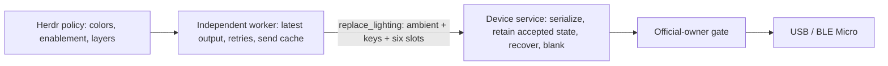

# Codex Micro bridge

## Current architecture

The integration has one device service and one optional Herdr policy client:

```text
stock Codex Micro firmware 0.6.2
  -> per-user dev.herdr.codex-micro LaunchAgent
     -> shared IOHIDManager transport: USB preferred, BLE supported
     -> lifecycle, official-writer gate, replay, reserved Handy action
     -> owner-only, exact-version typed Unix socket
  -> herdr-micro daemon (optional policy client)
     -> Herdr daemon sockets: client.list + client.changed + client.jump
     -> macOS keyboard events for prompts and Enter
     -> gestures, actions, and lighting policy
```

The complete lighting boundary keeps policy separate from device recovery:



The LaunchAgent runs without administrator privileges from
`~/Library/Application Support/dev.herdr.codex-micro/codex-micro`. It owns the
device connection, the official-writer gate, and reconnects. It closes the
physical device while Work Louder Input is running or ChatGPT/Codex desktop is
frontmost, then reopens and replays the latest state when that gate clears. USB
wins when USB and Bluetooth Low Energy are both available.

The local socket is mode `0600`, verifies the peer's effective UID, requires an
exact protocol version (2), bounds frames, and permits one device controller. Its
operations are typed: status, controller lifecycle, focused app, lighting, and
guarded keymap reads/writes. There is no generic raw device RPC and no path to
the device that bypasses the service. The physical-device gate is
service-owned.

`herdr-micro` connects directly to the device service and to the socket of
every running local Herdr session. Each daemon reports its attached clients;
the followed client, the one whose window most recently took focus, supplies
the agents, their order, and the jump target, also while another app is in
front. Hub has no client-facing role. With no followed client to show (none
has sent a report, or the followed client's daemon is not answering) Herdr
lighting and routing are blank, without stopping the device LaunchAgent.

## Device ownership

The service uses shared, unprivileged IOHIDManager access. It does not seize
the USB interface, detach a macOS driver, install a root helper, or require
`sudo`. macOS Input Monitoring must be granted to the stable installed service:

```sh
herdr plugin invoke gjermundgaraba.herdr-micro.service-authorize
```

Fresh-install behavior, Input Monitoring troubleshooting, and code-signing
notes are in the [README install section](../README.md#install).

The proprietary vendor channel still has a strict one-writer boundary. Work
Louder Input, the Codex desktop device writer, and this service are mutually
exclusive. The service and Herdr may both read the shared `external_owner()`
detector, but only the service enforces the gate by closing and reopening its
physical connection. Herdr uses that state only to suppress routing. Quit the
official writer for keymap setup; normal operation is gated automatically.
This is process coordination, not USB capture.

The service-owned device gate is:

| Owner state | Service result |
|---|---|
| Work Louder Input running | Close the physical device |
| ChatGPT/Codex desktop frontmost | Close the physical device |
| Official writer inactive | Open USB or BLE and replay desired state |

Separately, Herdr selects Layer 2 once a client is followed and routes
actions through it. Without a followed client, the bridge preserves the last
applicable Herdr layer and dispatches no Herdr action.

Layer 2 keeps `KV_OAI_AG00` through `KV_OAI_AG05` for six-way status lighting
and native action codes for configured controls. `micro-setup` accepts only a
blank or previously managed Layer 2, backs up the complete keymap, writes it
through the typed service operation, and verifies read-back.

## Reserved Handy action

Button 5 is the physical `ACT10` switch. It is permanently reserved by the
device service and must remain `null` in Herdr's `config.json`. On press, the
service consumes the event and runs Handy's `--toggle-transcription` command
directly.

This path has no F19 mapping and emits no CGEvent. It remains available
without a running Herdr session and does not depend on permission to synthesize
keyboard events. macOS can still temporarily deny access to the physical HID
keyboard during Secure Input or console ownership changes; this affects every
device button, including Handy. The service reports the access denial and
retries automatically. The other buttons, dial, joystick, gestures,
routing, and lighting policy remain Herdr-side. The stock wide keycap can
actuate both Button 5 and Button 6, so Button 6 is `null` by default.

## Herdr action scheduling

Session discovery runs `herdr session list --json` every three seconds on a
thread of its own and kills a listing that takes longer than five seconds, so
a slow listing never delays a focus change. Each session gets one worker that
subscribes to `client.changed`, reads `client.list`, and reconnects with
backoff. `client.changed` only names a client, so the worker reads
`client.list` again after each burst of changes; nothing is polled and the
subscription needs no heartbeat. A daemon whose subscription or listing fails
is logged with its own error, once per distinct error, counted as having no
clients, and asked again with a backoff of up to five seconds. A failed
discovery keeps the daemons already followed.

The followed client is the one that most recently started reporting
`focused: true`, across all daemons. The follower decides it per `client.list`
reading: a client that reports focus and did not in its daemon's reading
before takes over, and of several in one reading the one with the highest
client id. It stays followed while its window is not in front.

While no client is followed, a reporting client is followed anyway, picked
each time the follower publishes: one that reports `focused: true` before one
that reports `null` before one that reports `false`, and of equals the last
by socket path and then client id. A TUI reports `null` until its terminal
sends a focus change, so a TUI started in an already focused terminal is
followed this way; it is shown and jumped, but prompts and Enter are refused
until it has seen a focus change.

The followed client is forgotten when a reading of its daemon no longer
contains it (it detached, or the daemon restarted under another boot) or when
a session discovery no longer lists its daemon as running. A failed
subscription or listing, a timeout, or an undecodable event only takes the
daemon offline: the client is kept, but nothing is known about it, so nothing
is shown, jumped, or typed until the daemon lists it again, and no other
client is picked in the meantime unless one takes focus. The first reading
after such a gap is compared with the last one before it, so a client that
reported focus all along does not count as taking it.

The followed client's report is used as it is. Its `agents` rows are the
client's own Agents list, each with the endpoint it belongs to; `priority_key`
is the daemon's attention order, compared as bytes and never parsed. Slots use
endpoint-qualified pane identity. The row with `focused: true` drives
highlighting.
Routing updates never wait for device I/O. A separate worker retains only the
latest desired layer and lighting, compares actual light values, and writes
only changes. Terminal-title animations and other agent metadata do not resend
lights. Device errors are reported separately from Herdr routing failures.
Lighting uses `Client::replace_lighting` with a complete snapshot: `ambient`,
`keys`, and exactly six slots. Every replacement writes both aggregate zones
and all slots; disabled aggregates and `Lighting::default()` explicitly turn
lights off. Success means the service accepted the snapshot: connected device
writes completed under the transport contract, or an offline snapshot was
retained for replay. It does not promise visible hardware read-back.

A failed write can have partial physical effects. The service retains its last
accepted snapshot and replays it after reconnect, or blanks all lights if none
was accepted. Official-owner checks remain between writes and gate recovery.
The first controller acquisition after service restart establishes native
Layer 1 and complete blank lighting, including when a status check already
opened the device. Status queries alone do not reset lighting. Controller
disconnect restores Layer 1 and blanks every supported surface. The worker
invalidates its send cache before a lighting attempt so a lost IPC reply cannot
prevent a later replacement. Any protocol version other than 2 is rejected in
both directions; update both binaries together using the start flow above.

An Agent key becomes one `client.jump` carrying the client ID, the row's
endpoint ID, that endpoint's boot ID, and the pane ID. The daemon holds a
jump for up to twenty seconds, so jumps are sent by two threads of their own
and no press waits for an earlier answer. The input loop leaves each press in
a place for one, where a press not yet written gives way to the next. One
thread takes the press, checks that its client is still the followed one,
connects and writes the request with a 25-second socket deadline: jumps are
written one at a time in press order, and an older press is never written
after a newer one. The written jump goes to a second place for one, from
which the other thread reads the answers one at a time; a written jump still
waiting there when the next is written is closed unread. So there are two
threads and at most three connections however fast keys are pressed. The
daemon lets the jump it takes up last win, and nothing is logged for a jump
that gave way to a newer one, here or in the daemon. The daemon reads each
connection on a thread of its own, so two jumps written at the same instant
can still be taken up in the other order. A jump needs its client to be the
followed one still, not its window focused. None is repeated. A stale boot
ID, a missing pane, an endpoint that went away, a timeout, a departed client,
and a client that sends no report are distinct logged errors, each in words,
not as the API's error code.

Gestures capture the followed client and the kind of its focused agent at the
initial press. `prompt` and `submit` are keyboard events for the frontmost
app: the text as Unicode key events of at most 20 UTF-16 units, then, after
200 ms, Return with no modifiers. Before each of those keystrokes (every
chunk of text, and the Return) the worker checks that the bridge is still
running, that the captured client is still the followed one, and that its
window has focus in the last report the bridge received; if not, the rest is
dropped and never retargeted. A report that the client lost focus, or is no
longer the followed one, counts from the moment the follower receives it,
before the bridge's own loop has taken it up. The check reads that report, not macOS, so a keystroke sent after
the window lost focus but before its report arrived can reach the app that
took focus. Stopping the bridge drops queued prompts and submits.
Configuration changes and physical device disconnection clear pending
gestures.

Typing was chosen over pasting: it leaves the pasteboard alone, needs no
restore step that could race the paste or lose non-text contents, and does
not depend on the receiving app's paste binding. The 200 ms pause is there
because terminal agents treat an Enter that arrives with a burst of text as
part of a paste.

One worker runs accepted prompts and submits in FIFO order, with a queue of
16. `key` taps are posted directly and never wait for it.

## Compatibility and limitations

| Component | Current boundary |
|---|---|
| Platform | macOS only |
| Herdr | The custom Herdr build with the daemon client API (no Hub dependency) |
| Build toolchain | Rust 1.89 or newer |
| Codex Micro firmware | Stock 0.6.2 baseline; USB `device.status` physically confirmed |
| Device transport | USB preferred; Bluetooth Low Energy supported |

- The OAI HID protocol is proprietary and unsupported. Work Louder publishes
  firmware binaries, not a third-party SDK or writer-coordination contract.
- The current 0.6.2 confirmation is a USB status probe. Physical validation of
  the complete new service path and 0.6.2 BLE path is recorded separately when
  performed; the [research record](research/README.md) distinguishes it from
  older evidence.
- Only the six Agent keys are independently addressable for lighting on the
  tested Micro. Lower-key backlight and perimeter lighting are aggregate zones.
- Aggregate-zone synchronization flags have not been physically verified.
- Prompts and Enter go to whatever has keyboard focus inside the followed
  Herdr client, which is not necessarily an agent: a shell, a dialog, or a
  text field of the native app receives them too.
- The client API port has been tested against a mock daemon only; it has not
  been exercised on the device or against a running Herdr.

## Lifecycle

`bin/herdr-micro start` installs or refreshes the per-user LaunchAgent before
starting the Herdr client. The service is supervised independently and keeps
the reserved Handy action available without Herdr whenever its official-writer
gate is clear. `micro-stop` stops only the Herdr routing client; the service
continues owning its physical-device gate.

Before unlinking or uninstalling the plugin, remove the service while its
source binary still exists:

```sh
bin/codex-micro uninstall
```

This boots out `dev.herdr.codex-micro` and removes its LaunchAgent, installed
executable, and installation directory. It requires no administrator access.
